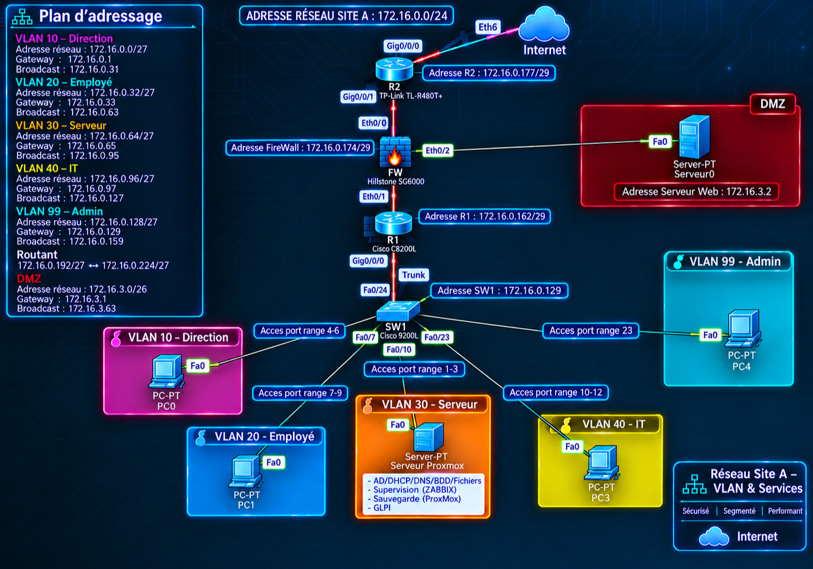

# Active Directory + GLPI deployment — Site A

[🇫🇷 Version française](README.md) · 🇬🇧 English

Lab work for the French professional qualification **Administrateur d'Infrastructures Sécurisées (AIS)**, which covers secure infrastructure administration, at GRETA Essonne.
It was built in a home lab (VirtualBox) between 6 and 11 October 2026.

## Project goal

The goal was to bring a company's **Site A** environment back into service using existing virtual machines:

- a **Windows Server 2022 domain controller** running Active Directory and DNS for the domain `exemple.lan`;
- a **GLPI 11 server** on Debian 13, connected to Active Directory over **LDAP**.

GLPI was then run like a real IT service desk: accounts imported from AD, user profiles, a hardware inventory, and one support ticket taken through its full lifecycle.

## Lab architecture

| Machine | Role | Lab address |
|---|---|---|
| Serveur_TP (`WIN-RG5VDD2MS10`, DC01) | Windows Server 2022: AD DS and DNS for `exemple.lan` | 192.168.56.10 |
| GLPI-Site-A (`glpi01`) | Debian 13: Apache, MariaDB, PHP, GLPI 11.0.4 | 192.168.56.20 |
| Windows host laptop | Test client (browser, RDP, SSH) | 192.168.56.1 |

Network: VirtualBox **host-only** `192.168.56.0/24`. GLPI also has a NAT adapter for internet access.

In the school design, servers sit in **VLAN 30 – Server (172.16.0.64/27)**. The lab uses a flat network with no VLANs or physical devices, so the switch, router and firewall were declared manually in GLPI.



## What I did (8 stages)

1. **Inventory of what exists.** I listed the existing VMs, their network adapters and their roles. Two problems showed up: the adapters were set to "not attached", and AD and GLPI were on different subnets.
2. **Network and DNS.** I moved everything onto 192.168.56.0/24, removed stale DNS records and registered `glpi01.exemple.lan`. Name resolution and connectivity were tested in both directions (GLPI → AD and AD → GLPI).
3. **Active Directory.**
   - OUs: `Utilisateurs` (with Direction, Employes and IT inside), `Groupes`, `Postes` and `ComptesService`.
   - Groups: `GRP-Direction`, `GRP-Employes`, `GRP-IT` and `GRP-GLPI-SVC`.
   - Accounts: `direction01`, `employe01`, `it01`, plus the `svc-glpi` service account, which is **not an admin**.
4. **LDAP link.** I created the `AD-Site-A` directory in GLPI with these settings, then tested the connection successfully and imported the users:
   - port 389;
   - Base DN `DC=exemple,DC=lan`;
   - bind account `svc-glpi`;
   - login field `samaccountname`;
   - sync field `objectGUID`.
5. **Profiles.** Requesters got Self-Service and `it01` got Technician. I verified the rights: `employe01` is refused access to the configuration pages.
6. **Inventory.**
   - Created the Site A entities and locations.
   - Added computers: DC01 was inventoried by the GLPI Agent; GLPI01 and CLIENT01 were declared manually.
   - Added the network devices.
   - Wrote up the GLPI Agent installation procedure.
7. **Ticket.** `employe01` opened an incident. It was assigned to `it01` and the IT group, followed up and resolved, then **closed** by the requester.
8. **Acceptance testing.** Every test in the test plan passed. Deviations and the corrections made are documented.

## Answers to the lab questions (short version)

1. **VM IP vs host IP:** The hypervisor's IP is only used to manage it. Each VM has its own virtual network card (its own MAC and IP), so GLPI is reached at the GLPI VM's IP (192.168.56.20), not the host's.
2. **Internet DNS on GLPI:** An internet DNS server does not know the internal zone `exemple.lan`, so GLPI cannot find the domain controller: LDAP and AD logins fail (NXDOMAIN observed in the lab).
3. **Separate OUs:** They let you apply different rules to each object type (GPO, delegation, rights), keep the directory readable, and limit GLPI's LDAP search to real users.
4. **objectGUID:** A unique ID that never changes, even if the account is renamed or moved, so GLPI always recognises the same person and keeps their tickets and assets linked.
5. **Limiting Self-Service:** This is least privilege. Otherwise a user could give themselves admin rights, redirect tickets or falsify the inventory.
6. **What an agent reports:** Computer name, operating system, manufacturer, model and serial number, CPU, RAM, disks, network cards (IP, MAC), installed software and the logged-in user.
7. **Solved vs Closed:** Solved means the technician applied and documented the fix. Closed means the requester approved it (or a time limit expired) and the ticket is locked. Until it is closed, the requester can refuse the solution and the ticket reopens.

## Main issues fixed

| Issue | Fix |
|---|---|
| VirtualBox network adapters set to "not attached" | Attached to the host-only network, cable connected |
| AD and GLPI on two subnets with no routing between them | GLPI moved to 192.168.56.20 |
| The GLPI VM was also used by another class | Full clone "GLPI-Site-A"; the original is untouched |
| Stale DNS records; the AD's own DNS client pointed to 8.8.8.8 | Records cleaned up; the AD now uses itself for DNS |
| dhcpcd kept overwriting `resolv.conf` | Added `nohook resolv.conf` and restarted the interface |
| The old LDAP directory used a domain admin account | New directory using the `svc-glpi` service account |

I troubleshot in a fixed order (**network → IP → DNS → AD → LDAP → GLPI**) and took a snapshot before every change.

## Follow-up mission: securing and acceptance testing (13 October 2026)

Same VMs, folder [`mission-securisation/`](mission-securisation/):

1. **Service status** — ADWS, DNS, DHCP, AD domain, Apache, MariaDB, disk and memory checked.
2. **Connectivity and DNS** — GLPI ↔ AD by IP and by name; port 80 open, 443 closed (GLPI is HTTP only).
3. **Named admin account** — `admin-sitea` in the `sudo` group, `sudo whoami` → root.
4. **SSH and firewall** — `PermitRootLogin no` (checked with `sshd -t` / `sshd -T`); UFW denies incoming by default, only 22/TCP and 80/TCP open; MariaDB listens on 127.0.0.1 only.
5. **Logs** — journalctl (ssh, apache2, mariadb) and Windows (Security 4624, System, DNS Server).
6. **GLPI ticket** — request #2 "Sécurisation de l'accès d'administration au serveur GLPI Site A", category Sécurité > Administration serveur, solved then closed.
7. **Acceptance tests** — every check passed.

Incidents handled: the GLPI VM crashed (host out of memory) → restored the snapshot taken before the change; LDAP error after enabling UFW → ping + port 389 diagnosis showed the domain controller was switched off, not a firewall issue.

## Repository contents

```
rapport/   full lab report (HTML + PDF, in French)
captures/  89 screenshots sorted by stage (evidence)
docs/      key-concepts reference guide (PDF, English), incl. lab access and 8-stage replay
mission-securisation/
  rapport/   mission report (HTML + PDF, in French)
  captures/  evidence screenshots sorted by stage
  docs/      mission key-concepts guide (PDF, English), incl. lab access and replay
```

## Security

This repository contains no passwords, keys or secrets, and neither do the screenshots. All addresses belong to a private host-only lab.

## Limitations and next steps

- LDAP is unencrypted on port 389; the next step is **LDAPS on port 636**.
- There is no Windows client VM yet; the plan is to add one with the **GLPI Agent** (option A).
- AD groups are not yet synced automatically to GLPI groups.

---
Charles MADUBA — AIS professional qualification
